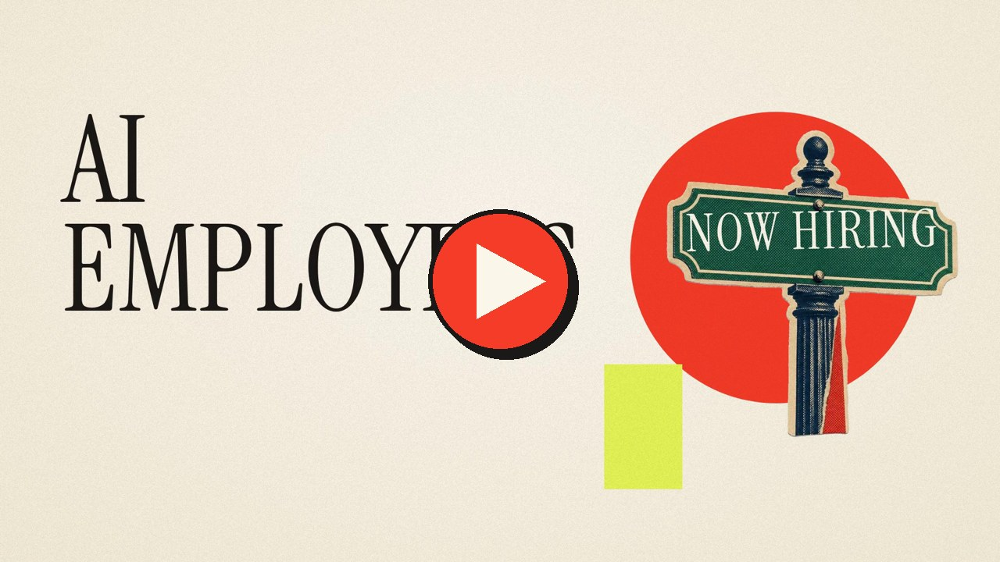

# AI Employee Workshop

Build your first AI employee in about 90 minutes. No code. You need a free GitHub account and either Claude or ChatGPT.

An AI employee is three things:

1. **A folder in your GitHub repo** that holds its instructions: who it is, what it owns, what it must never do.
2. **Skills**: the step-by-step "how" for each job it does, written as files in that folder.
3. **A routine**: a schedule that wakes it up and sends it to work. Daily, weekly, whenever you decide.

You set it up by chatting with your AI. The AI writes the files and saves them to GitHub for you. Then you train it with a week of feedback, and it gets better every time you correct it.

---

## Watch The Tutorial (11 minutes)

[](https://github.com/emmeliedelacruz/ai-employee/raw/main/video/tutorial.mp4)

Click the image to play. It walks through the whole setup on screen, from making the repo to your first week of training.

---

## How To Use This Repo

**Drop this link into Claude Code or ChatGPT. Your AI does the rest.**

```
https://github.com/emmeliedelacruz/ai-employee
```

You do not paste a prompt. You do not upload files. Your AI reads this repo, checks where you are, and gets to work. It asks you a few questions at a time and writes every file for you.

1. **Watch the tutorial** above so you know where you are going.
2. **Pick your AI.** Claude gives you the full hands-off setup. ChatGPT works with two manual steps. See the comparison below.
3. **Drop the link** and answer your AI's questions. Give it as much detail as you can.
4. **Review the output every day for a week.** Give feedback in the same chat. Your AI updates the skill.
5. **Repeat** for your next employee. Drop the same link again.

If your AI cannot open links, download `README.md` from this repo and attach it to your chat. If you would rather click through it yourself, follow [CLIENT-SETUP-GUIDE.md](CLIENT-SETUP-GUIDE.md).

### What Happens After You Drop The Link

Your AI checks your repo and picks up where you left off. You never choose a step.

| Where you are | What your AI does |
| --- | --- |
| New, no repo yet | Helps you make a GitHub repo and connect it, then learns who you and your company are, then captures your voice |
| Repo, context, and voice are done | Builds your first employee, its first skill, and its routine |
| Adding a second employee | Builds the next employee in the same repo |
| An output was wrong | Say what was wrong in the same chat. Your AI updates the skill |

---

## What You Will Have At The End

```
ai-employees/
  CLAUDE.md                        shared rules for every employee
  shared/
    context/SKILL.md               who you are and what your company does
    voice-and-tone/SKILL.md        how you sound
  roles/
    your-first-employee/
      CLAUDE.md                    who they are, what they own, what they never do
      reference/                   your SOPs, samples, what good looks like, and test inputs (evals)
      logs/                        optional record of what they did
      .claude/skills/
        your-first-skill/SKILL.md  one job, step by step
```

Plus a routine that runs it on a schedule. You never create these files yourself. Your AI does.

---

## Week One At A Glance

| Day | You | Your employee |
| --- | --- | --- |
| 1 | Build it and run it once by hand | Delivers a draft |
| 2 to 6 | Read each output. Say what was wrong and how to do it next time | The skill updates. The next run uses the new version |
| 7 | Decide: ready to run on its own, or one more week | Runs the schedule |

Do not skip the daily review. People set up an AI, skip the review, and decide AI does not work.

---

## Claude Or ChatGPT?

| | Claude | ChatGPT |
| --- | --- | --- |
| Builds your employee in chat | Yes | Yes |
| Saves files to GitHub for you | Yes (Claude Code in the cloud) | Partly. You need to have the github plugin installed |
| Runs on a schedule without your computer | Yes (Routines) | Yes (Scheduled tasks), but test that it can read your repo |
| Best for | The full hands-off setup | People already working in ChatGPT |

If you are unsure, start with Claude. Plan requirements: Claude Pro or higher for Claude Code and Routines. A paid ChatGPT plan for scheduled tasks. Last checked October 2026. Menus move, so if a button has a different name, ask your AI where it went.

---

## Fast Start Timeline

| Step | What you do | Time |
| --- | --- | --- |
| 1 | Make a GitHub account and an empty repo called `ai-employees` | 10 min |
| 2 | Connect the repo to Claude or ChatGPT | 10 min |
| 3 | Create a context file by telling your AI about you and your company, and capture your voice. | 20 min |
| 4 | Chat with your AI. It interviews you and builds your employee and its first skill | 30 min |
| 5 | Create the routine so it runs on a schedule | 10 min |
| 6 | Give feedback for one week. Your AI updates the skills for you | 5 min a day |
| 7 | Repeat for your next employee | |

---

## What Is In This Repo

| File or folder | What it is | When you use it |
| --- | --- | --- |
| [CLIENT-SETUP-GUIDE.md](CLIENT-SETUP-GUIDE.md) | The step-by-step guide with exact clicks | Start here if you want to follow along yourself |
| `ai-agent-prework/` | Your AI connects your repo, learns who you and your company are, and captures your voice | Once, before your first employee. About 40 minutes |
| `ai-agent-workshop/` | The guided build. Your AI interviews you, writes the employee, builds and tests the first skill, and sets up the routine | Every time you build an employee |
| `templates/` | The exact files your AI creates in your repo | When you want to see what you are getting |
| `video/` | The tutorial | Watch it first |

---

## Words In Plain English

- **Repo**: a folder on GitHub. Think of it as a Google Drive for your skills.
- **Main**: the live version of your repo. Skills only work for your routine once they are saved to main.
- **Skill**: one job, written down step by step, as a file your employee follows.
- **Routine**: a schedule that wakes your employee up and sends it to work.
- **Connector**: a link from your AI to a tool like Gmail or Slack. Give each employee only the ones it needs.
- **Shadow mode**: your first week. Your employee drafts. You approve. Nothing goes out on its own.

---

## Who This Is For

Non-technical founders, operators, and service providers who want to stop doing repeatable work. You need to know your business and the role you would hire for tomorrow. Client onboarding, content operations, reporting, inbox management, legal and contract review, and project coordination are the clearest fits.

---

## Instructions For The AI

If a person dropped this repo link into your chat, start now. Do not ask them to paste a prompt or upload files.

1. Read `ai-agent-prework/SKILL.md` and `ai-agent-workshop/SKILL.md`.
2. Find out where they are. Check for their `ai-employees` repo, `shared/context/SKILL.md`, and `shared/voice-and-tone/SKILL.md`.
3. If anything is missing, run the matching part of `ai-agent-prework/SKILL.md`. When it is done, move straight into `ai-agent-workshop/SKILL.md` in the same chat.
4. If everything exists, run `ai-agent-workshop/SKILL.md` to build the next employee.
5. Save every change straight to main in their `ai-employees` repo. Never ask them to edit a file.
6. Speak plainly. Ask one or two questions at a time.

---

## About

Built by Emmelie De La Cruz. Head of Growth at Bubble.io. Founder of VILLA, an AI-powered async marketing agency. Creator of Sanity and Success and Foot on Necks.

15 years building marketing systems, funnels, automations, and agencies. This workshop is the same system I use to onboard clients and the same methodology I used to convert my own agency's human SOPs into AI agents.

admin@agencyvilla.com
[https://linkedin.com/in/emmeliedelacruz](https://linkedin.com/in/emmeliedelacruz)
